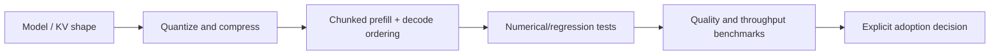

# Fork qualification notes — TurboQuant KV-cache experiments

**Scope:** public source-evaluation fork of TurboQuant. **Status:** experimental qualification; no production inference deployment is asserted.

## What this fork is for
Upstream describes quantized KV-cache compression for LLM inference and vLLM integration. Runtime applicability depends on the specific model attention architecture, precision, prefill schedule, cache layout, hardware/software environment and acceptance thresholds. Benchmark results from one machine are not transferable to another without evidence.

## Known evaluation focus
A 2026 fork evaluation investigated **chunked prefill-order correctness** in the CPU reference/qualification path. One controlled patch series reported 130/130 bounded CPU cases passing; that result is valid only for its pinned source and fixtures. Synthetic compression ratios and cosine-quality regressions are separate measurements, not proof of useful end-to-end model quality or deployment.

## Verification checklist
- Pin exact fork commit, upstream commit, model config, hardware, toolchain and RNG seeds.
- Verify prefill chunk order, sequence boundaries, decoding continuity, attention-score deviations and quantization error.
- Report quality and performance together, including negative samples and reproducible controls; do not compare synthetic CPU fixtures to GPU vLLM production as if equivalent.
- Keep GPLv3 license/source and original copyright notices intact; use normal upstream contribution practice for original corrections.

**Boundary:** source tests and public benchmark descriptions do not authorize access to unrelated private runtimes, model stores or production traffic.
